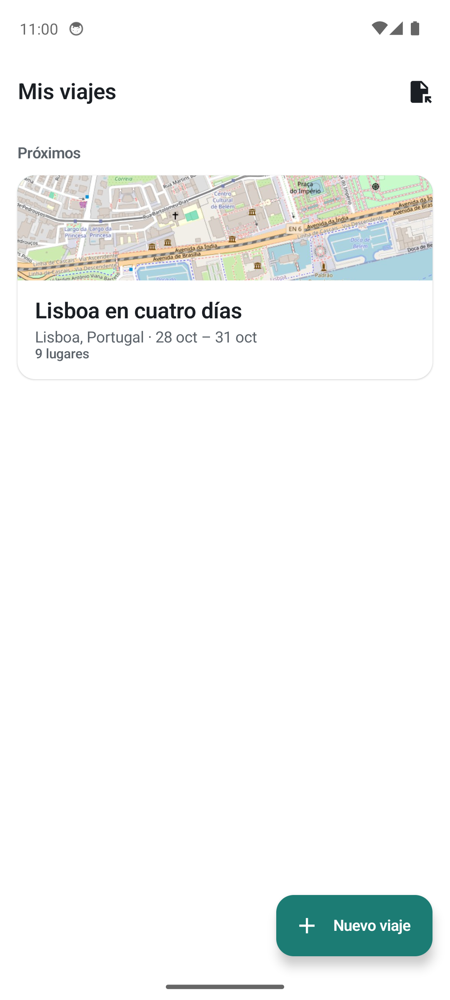
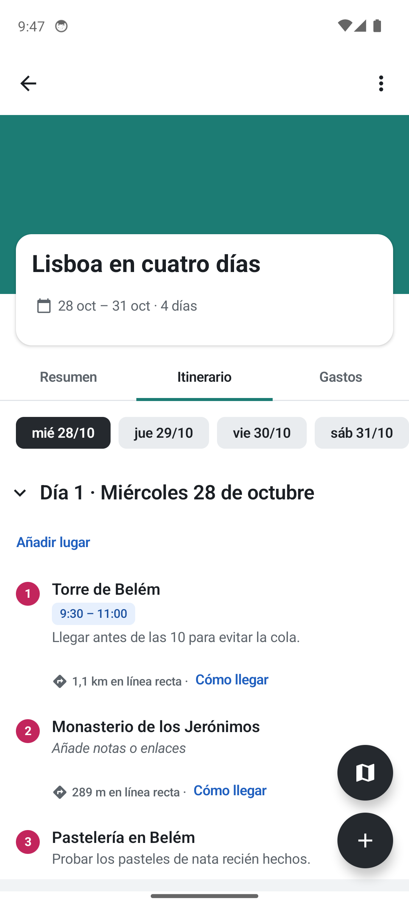
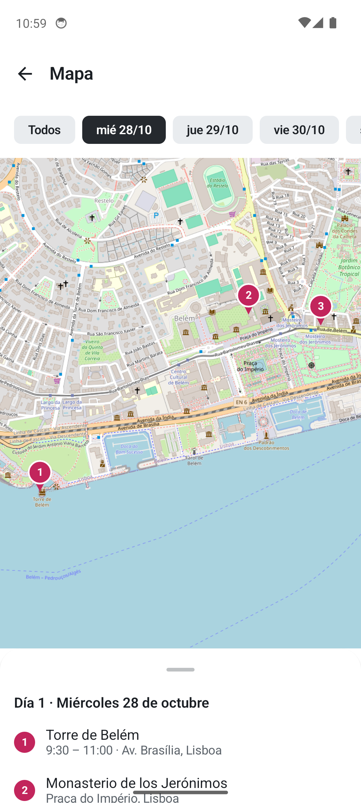
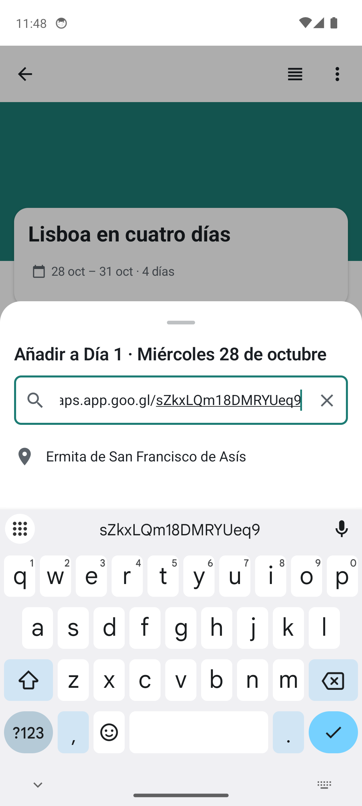
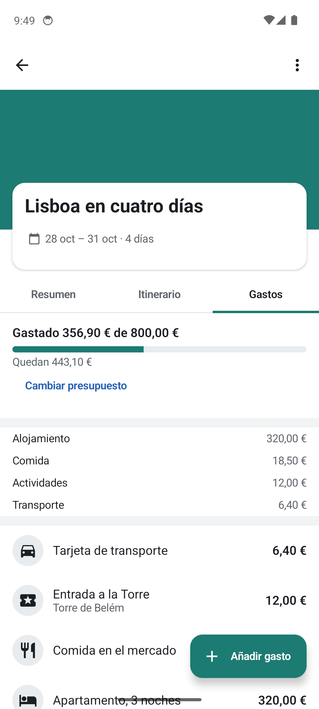
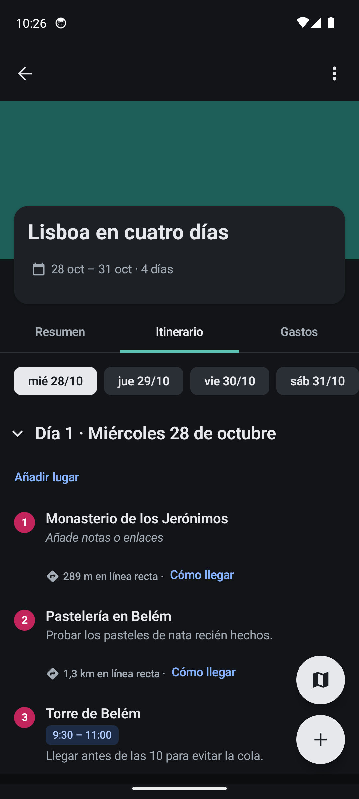

<div align="center">


# TripPlanner

**Planifica tus viajes día a día, con mapa, horarios y presupuesto. En tu móvil, sin cuentas y sin internet.**


&nbsp;
&nbsp;


</div>

---

## ✨ Qué hace

**🗓️ Itinerario por días.** Creas un viaje con destino y fechas y la app monta un día por cada fecha. Añades lugares, les pones hora de inicio y fin, los arrastras para reordenarlos (también de un día a otro) y ves la distancia entre paradas y el total del día. Si cambias las fechas, el orden se mantiene.

**📍 Lugares desde Google Maps.** Busca por nombre o dirección, o pega directamente lo que comparte la app de Google Maps: enlaces cortos (`maps.app.goo.gl/…`), enlaces largos o coordenadas sueltas. Sirve para ermitas, miradores, hides y sitios que un buscador normal no encuentra.

**🗺️ Mapa.** Todos los lugares con chinchetas numeradas y con el color de su día, con filtro por día y la lista debajo. Desde cualquier lugar, "Cómo llegar" abre la ruta en Google Maps.

**💶 Gastos y presupuesto.** Fijas un presupuesto, apuntas gastos (opcionalmente ligados a un lugar) y ves lo gastado, lo que queda y el reparto por categorías.

**📝 Notas y listas.** Notas del viaje que se guardan solas, listas propias ("Restaurantes", "Si sobra tiempo"…) y una lista de la maleta con casillas.

**📤 Exportar e imprimir.** Copia de seguridad del viaje en un archivo y vuelta a importarla, exportación a KML para Google My Maps, el itinerario en texto para compartirlo por cualquier app, e impresión o PDF.

**🌙 Y además:** modo oscuro que sigue al sistema, foto de portada, vista compacta, mover o borrar varios lugares a la vez, y "Deshacer" tras cada borrado.

<div align="center">
&nbsp;
&nbsp;

</div>

## 🔒 Tus datos son tuyos

- **Sin cuenta, sin registro, sin publicidad.** Abres la app y empiezas a planificar.
- **Todo se guarda en el móvil**, en una base de datos local. No hay servidor.
- **Funciona sin conexión.** Internet solo hace falta para buscar lugares, leer enlaces de Google Maps y descargar el mapa.

## 🧱 Cómo está hecha

| Capa | Tecnología |
| --- | --- |
| UI | Jetpack Compose + Material 3, navegación con Navigation Compose |
| Datos | Room 2.6 (SQLite) con migraciones y esquema exportado en `app/schemas/` |
| Mapa | [osmdroid](https://github.com/osmdroid/osmdroid) con teselas de OpenStreetMap |
| Búsqueda | `Geocoder` de Android, más la lectura de enlaces de Google Maps |
| Reordenar | [Reorderable](https://github.com/Calvin-LL/Reorderable) para arrastrar y soltar |
| Arquitectura | ViewModels + `StateFlow`, repositorio único, inyección manual de dependencias |

```
app/src/main/java/com/cuchieman/tripplanner/
├── data/            Room (entidades, DAO, migraciones), repositorio, copias, enlaces de Maps
├── ui/
│   ├── screens/     home · create · trip (resumen, itinerario, gastos) · expense · map · settings
│   ├── components/  piezas reutilizables
│   ├── design/      catálogo de componentes
│   └── theme/       colores, tipografía y tokens de diseño
├── MainActivity.kt
└── TripPlannerApplication.kt   dependencias de la app
```

## 🚀 Compilar y ejecutar

Necesitas **JDK 17** y el **Android SDK** (API 34). Con Android Studio basta con abrir la carpeta y pulsar ▶.

Desde la terminal:

```bash
./gradlew assembleDebug
```

```bash
./gradlew installDebug
```

En Windows, `run.ps1` lo hace todo de una vez: arranca el emulador si no está encendido, compila, instala y abre la app.

```powershell
.\run.ps1
```

## 🧪 Tests

74 tests instrumentados con Compose UI Test y Espresso: flujos completos de pantalla, repositorio, migraciones de Room, copias de seguridad, casos límite (doble toque, textos larguísimos, emojis) y lectura de enlaces de Google Maps.

```bash
./gradlew connectedDebugAndroidTest
```

> ⚠️ Los tests crean y borran datos. Lánzalos en un **emulador**, no en tu móvil: si tienes varios dispositivos conectados, fija `ANDROID_SERIAL` (por ejemplo `ANDROID_SERIAL=emulator-5554`) antes de ejecutarlos.

## 🗺️ Créditos

- Mapas © [colaboradores de OpenStreetMap](https://www.openstreetmap.org/copyright).
- Iconos de [Material Symbols](https://fonts.google.com/icons).
- Hecha con la ayuda de [Claude Code](https://claude.com/claude-code).
